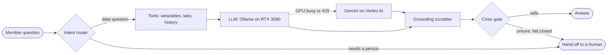

<div align="center">

<a href="https://moeezahmadkhan.com"></a>

###  Hi, I'm Moeez. I build LLM agents and get them running in production.

<a href="https://moeezahmadkhan.com"></a>
<a href="https://www.linkedin.com/in/moeez-ahmad-khan-68a403364"></a>
<a href="mailto:kmoeez2018@gmail.com"></a>
<a href="https://www.instagram.com/moozisthebest"></a>
<a href="https://github.com/moeezahmadkhan?tab=repositories"></a>

**[What I do](#what-i-do)** · **[Projects](#featured-projects)** · **[How my agents work](#how-my-agents-work)** · **[Stack](#stack)** · **[Stats](#github-stats)** · **[Contact](#lets-talk)**

</div>

---

I build LLM agents and computer-vision systems and get them running in production. I also do
the work around the model: safety gates, evaluation, inference and the infrastructure that
keeps it all up.

| | |
|---|---|
| 🔭 **Building** | A health AI agent for a US telehealth platform that answers from real wearable data, labs and history |
| 🧪 **Testing** | Replay suites of hundreds of real conversations, re-run before every fix ships |
| 💬 **Ask me about** | LLM agents · [MCP](https://github.com/moeezahmadkhan/DropshippingMcpAmazon) · LLM evals · local inference · [edge vision](https://github.com/moeezahmadkhan/vanguard) |
| 📍 **Based in** | Lahore, Pakistan |

### What I do

<sub>Click a section to open it.</sub>

<details open>
<summary><b>🤖 1 · Agentic LLM systems and RAG</b></summary>

- Agents that route intent, call tools, remember context and hand off to people
- Health AI agent for a US telehealth platform (private), grounded in wearables, labs and history
- **See:** [Relay](https://github.com/moeezahmadkhan/Relay-LabLab) · [amazon-sheet-mcp](https://github.com/moeezahmadkhan/DropshippingMcpAmazon)

</details>

<details>
<summary><b>🛡️ 2 · LLM safety, grounding and evaluation</b></summary>

- Crisis gates that fail closed
- Grounding scrubbers for invented data and wrong dates
- Replay suites of hundreds of real conversations before every ship
- **See:** [email-extraction-ladder](https://github.com/moeezahmadkhan/email-extraction-ladder)

</details>

<details>
<summary><b>⚡ 3 · High-performance local inference</b></summary>

- Ollama on an RTX 3090, falling back to Gemini on Vertex AI
- Fixed latency stalls and a pool deadlock under concurrent chats

</details>

<details>
<summary><b>👁️ 4 · Edge computer vision</b></summary>

- Real-time vision pipelines that run on the device
- **See:** [Vanguard](https://github.com/moeezahmadkhan/vanguard): attendance, activity auditing, perimeter alerts

</details>

<details>
<summary><b>🐳 5 · Containerized AI infrastructure</b></summary>

- Docker on AWS (EC2, S3, SSM), Hetzner and GPU clouds, under pm2
- Migrated a production stack from AWS to Hetzner arm64
- **See:** [Nexis](https://github.com/moeezahmadkhan/nexis)

</details>

### Featured projects

<table>
<tr>
<td width="50%" valign="top">

**[🔁 Relay](https://github.com/moeezahmadkhan/Relay-LabLab)**<br>
A multi-agent PR pipeline: four agents in four frameworks, built for a hackathon.<br>
<a href="https://github.com/moeezahmadkhan/Relay-LabLab"></a>
<a href="https://github.com/moeezahmadkhan/Relay-LabLab"></a>

</td>
<td width="50%" valign="top">

**[🛒 amazon-sheet-mcp](https://github.com/moeezahmadkhan/DropshippingMcpAmazon)**<br>
An MCP server that scrapes Amazon UK product data into a Google Sheet for eBay pricing.<br>
<a href="https://github.com/moeezahmadkhan/DropshippingMcpAmazon"></a>
<a href="https://github.com/moeezahmadkhan/DropshippingMcpAmazon"></a>

</td>
</tr>
<tr>
<td width="50%" valign="top">

**[✉️ email-extraction-ladder](https://github.com/moeezahmadkhan/email-extraction-ladder)**<br>
An LLM reads each email, and plain Python checks its answer.<br>
<a href="https://github.com/moeezahmadkhan/email-extraction-ladder"></a>
<a href="https://github.com/moeezahmadkhan/email-extraction-ladder"></a>

</td>
<td width="50%" valign="top">

**[👁️ Vanguard](https://github.com/moeezahmadkhan/vanguard)**<br>
Biometric attendance, activity auditing and perimeter alerts on edge hardware.<br>
<a href="https://github.com/moeezahmadkhan/vanguard"></a>
<a href="https://github.com/moeezahmadkhan/vanguard"></a>

</td>
</tr>
<tr>
<td colspan="2" valign="top">

**[🧩 Nexis](https://github.com/moeezahmadkhan/nexis)**<br>
A NestJS API with a separate FastAPI ML engine.<br>
<a href="https://github.com/moeezahmadkhan/nexis"></a>
<a href="https://github.com/moeezahmadkhan/nexis"></a>
<a href="https://github.com/moeezahmadkhan/nexis"></a>

</td>
</tr>
</table>

<p align="center"><a href="https://github.com/moeezahmadkhan?tab=repositories"><b>See all repositories →</b></a></p>

### How my agents work

<details>
<summary><b>🧭 How one of my agents answers a question</b> (diagram, zoom and pan on GitHub)</summary>



</details>

### Stack

<p align="center">
  <a href="https://skillicons.dev">
    
  </a>
</p>

```text
LLMs & agents   Ollama · Gemini / Vertex AI · OpenRouter · RAG · Qdrant · MCP · LLM evals
ML & vision     PyTorch · TensorFlow · edge inference · pandas · NumPy
serving         Python · FastAPI · NestJS · TypeScript · PostgreSQL · Supabase · Redis
infra           Docker · AWS · Hetzner · pm2 · CUDA (RTX 3090) · vast.ai / RunPod
```

### GitHub stats

<table><tr>
<td width="55%" valign="top">
<a href="https://github.com/moeezahmadkhan"></a>
</td>
<td width="45%" valign="top">
<a href="https://github.com/moeezahmadkhan?tab=repositories"></a>
</td>
</tr></table>

<p align="center">
  
</p>

<p align="center">
  <a href="https://github.com/moeezahmadkhan"></a>
</p>

<p align="center">
  <picture>
    <source media="(prefers-color-scheme: dark)" srcset="https://raw.githubusercontent.com/moeezahmadkhan/MoeezAhmadKhan/output/github-snake-dark.svg">
    
  </picture>
</p>

### Let's talk

<div align="center">

Building an agent, an eval suite or an edge-vision pipeline? I'm happy to talk about it.

<a href="mailto:kmoeez2018@gmail.com"></a>
<a href="https://www.linkedin.com/in/moeez-ahmad-khan-68a403364"></a>


</div>

<sub>GitHub Actions rebuild the chart (`scripts/contrib_chart.py`) and the snake daily. The banner and silhouette come from `scripts/avatar.py`.</sub>
